# HOL-2501-01-VCF-L - VCF Operations - Getting Started

## 🧭 Tổng quan Lab

- **Mã Lab:** HOL-2501-01-VCF-L_5.2
- **Tên:** VCF Operations – Getting Started
- **Nền tảng:** VMware Cloud Foundation 5.2
- **Thời lượng:** ~165 phút (tất cả modules)
- **Cấp độ:** Basic
- **Phòng lab:** VMware Hands-on Labs (HOL)

### Mô tả

Tìm hiểu cách nhanh nhất để khai thác giá trị từ Aria Operations: quản lý dung lượng, troubleshooting, bảo mật, tuân thủ, chi phí và hiệu quả vận hành.

### Mục lục modules

| Module | Tên | Thời lượng | Giảng viên |
|--------|-----|------------|------------|
| 1 | Maximize Your Value with Aria Operations | 15 phút | Shannon Fitzpatrick |
| 2 | Gaining Insights into your Capacity | 15 phút | Shannon Fitzpatrick |
| 3 | Mastering Monitoring and Troubleshooting Essentials | 30 phút | William De Marigny |
| 4 | Running a Safe and Compliant Cloud | 30 phút | William De Marigny |
| 5 | Understand your Cloud Costs and Save Money | 30 phút | Shannon Fitzpatrick |
| 6 | Generating Reports for Cost, Capacity, Compliance and More | 30 phút | William De Marigny |
| 7 | Visualizing the Health of your Private Cloud with VCF Diagnostics | 15 phút | Christopher Lewis & Shannon Fitzpatrick |

### Danh sách hình ảnh tham chiếu

Tất cả hình ảnh được lưu tại thư mục `images/` với định dạng `hol-2501-01-vcf-l_5.2_{số thứ tự}.png`. Số thứ tự tương ứng với trang PDF.

---

## Module 1 — Maximize Your Value with Aria Operations (15 phút)

- **Mục tiêu:** Làm quen giao diện VMware Aria Operations, biết cách đăng nhập và sử dụng các chức năng điều hướng cơ bản
- **Mục đích:** Giúp học viên nắm được tổng quan về nền tảng Aria Operations để chuẩn bị cho các module chuyên sâu sau
- **Lợi ích thực tiễn:** Admin có thể tự tin thao tác trên Aria Operations ngay sau khi cài đặt, biết cách tìm kiếm object, xem chi tiết và điều hướng nhanh đến các tính năng quản trị vận hành

### Chi tiết các bước thực hành

#### 1. Đăng nhập Aria Operations qua Workspace ONE Access (SSO)

1. Click **Firefox** icon trên Windows Quick Launch Task Bar
2. Click **VCF Cloud Management** bookmark folder
3. Click **Aria Operations**
4. Chọn **Workspace ONE Access** từ dropdown authentication source
5. Click **REDIRECT**

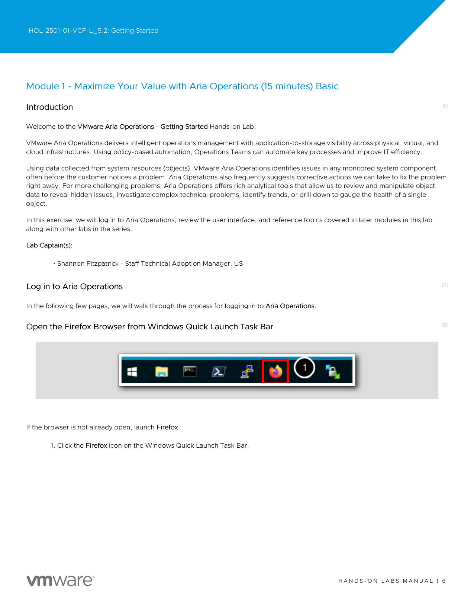
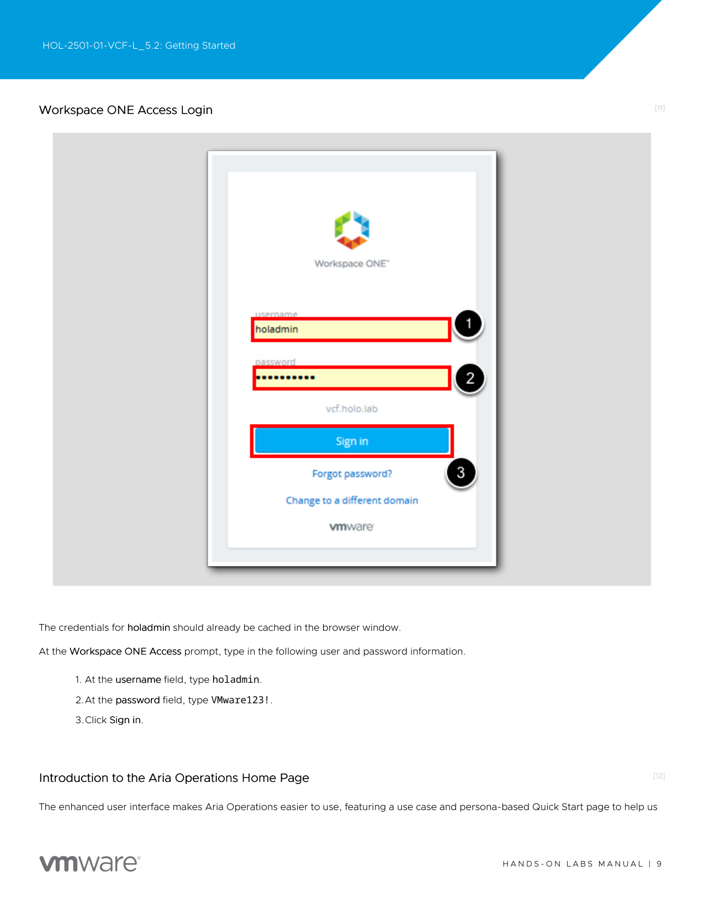

**Thông tin đăng nhập:**
- Username: `holadmin`
- Password: `VMware123!`

#### 2. Làm quen Aria Operations Home Page

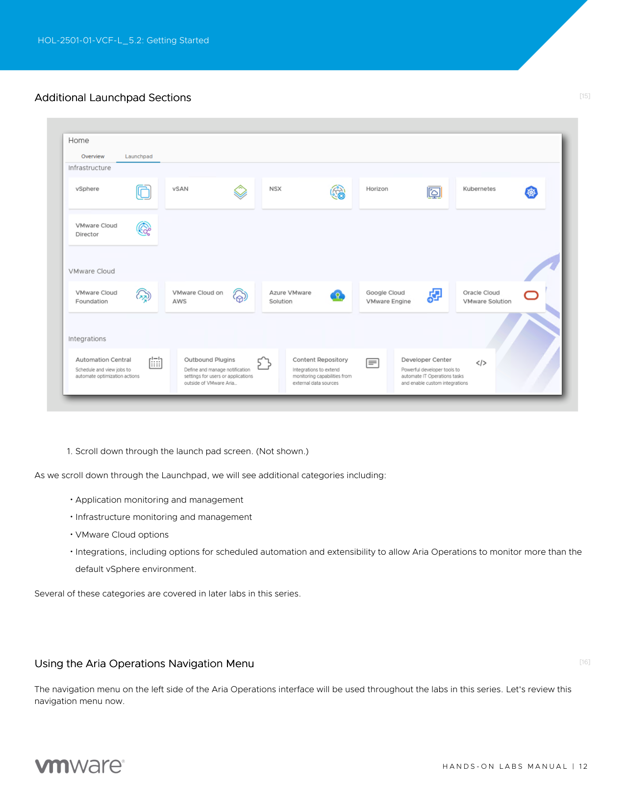

**Các thành phần chính:**
- **Left Navigation Menu:** Menu điều hướng trái, có thể collapse bằng icon `<<` / `>>`
- **Launchpad Tab:** Chứa **5 Pillars of Operations**
  - **Observability** — Monitoring & Troubleshooting (Module 3)
  - **Capacity** — Rightsizing & Reclamation (Module 2)
  - **Cost** — VM Costing, Rate Cards (Module 5)
  - **Compliance** — Industry Benchmarks (Module 4)
  - **Sustainability** — VMware Green Score
- **Top Search Bar:** Tìm kiếm global

#### 3. Khám phá Navigation Menu

- **Home:** Quay lại Launchpad
- **Inventory:** Tree view tất cả objects (Datacenter → Cluster → Host → VM)
- **Administration:** Quản lý user, credentials, integration, policies

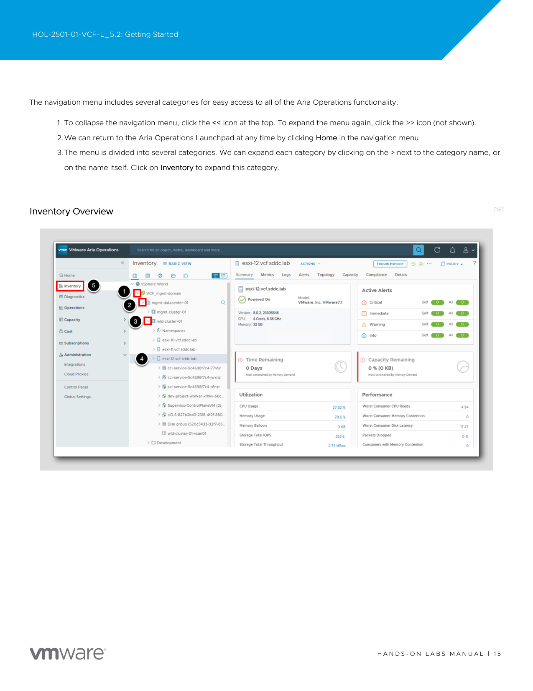

**Thao tác:**
- Expand `vSphere World > VCF_mgmt-domain > mgmt-datacenter-01 > wld-cluster-01`
- Click vào ESXi host để xem object detail

#### 4. Sử dụng Global Search

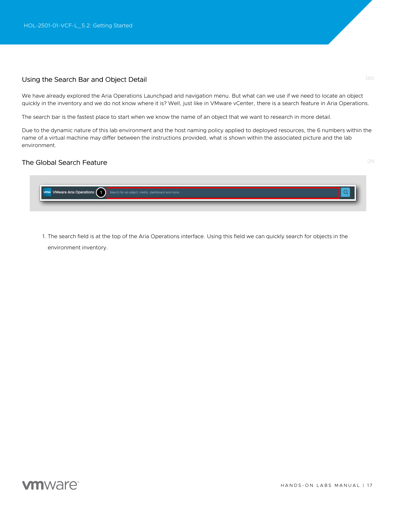

1. Nhập `windows` vào search field
2. Chọn VM `windows-001202`
3. Xem **Object Detail Page**: Summary, Alerts, Capacity, Configuration, Timeline

#### 5. Logout

- Click **Preferences > Log Out**

---

## Module 2 — Gaining Insights into your Capacity (15 phút)

- **Mục tiêu:** Sử dụng các Capacity Dashboards có sẵn để đánh giá dung lượng và thời gian còn lại của môi trường
- **Mục đích:** Giúp quản trị viên chủ động trong việc lập kế hoạch mở rộng hạ tầng dựa trên dữ liệu thực tế
- **Lợi ích thực tiễn:** Tránh tình trạng hết tài nguyên đột ngột; dự đoán được thời điểm cần nâng cấp; tiết kiệm chi phí nhờ tối ưu dung lượng hiện có thay vì mua mới ngay

### Chi tiết các bước thực hành

#### 1. Capacity Dashboards Overview

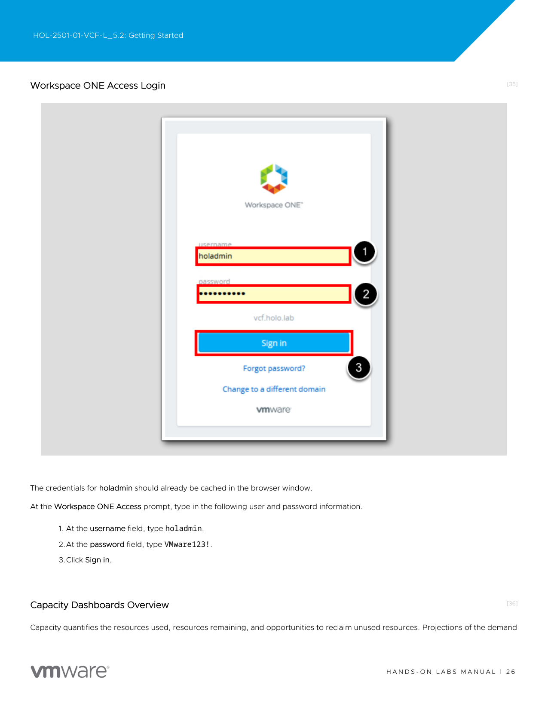

**7 Capacity Dashboards có sẵn:**
- **Cluster Capacity Dashboard** — Capacity & configuration clusters, hosts, resource pools
- **Datastore Capacity Dashboard** — Storage overview, datastores cần chú ý
- **Reclamation Dashboard** — Quản lý reclaim VM và datastore
- **VM Rightsizing Dashboard** — Điều chỉnh kích thước VM
- *... và các dashboard khác*

**Cách truy cập:**
- `Operations > Dashboards` → search "capacity"

#### 2. Capacity Pillar

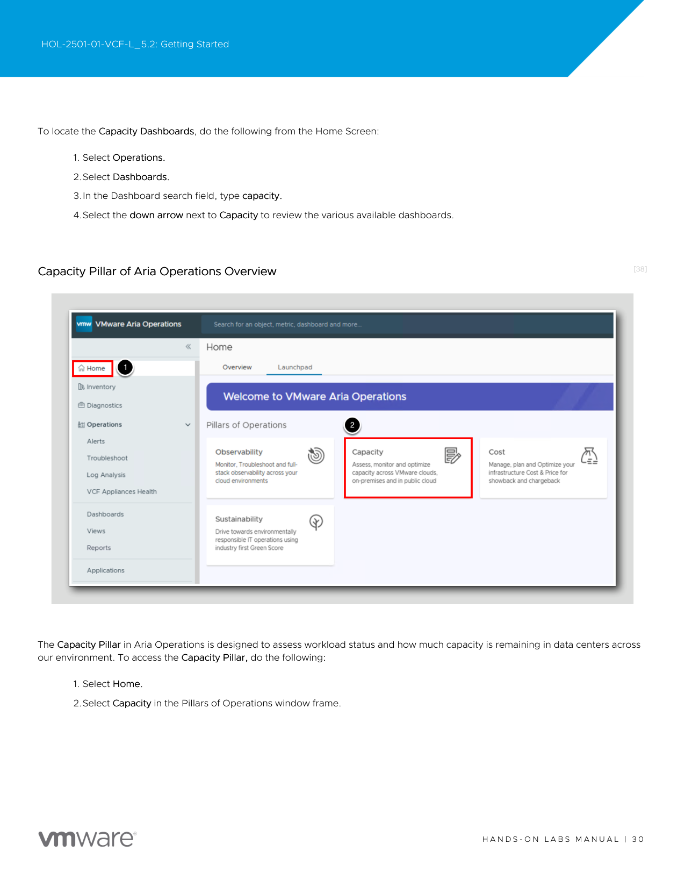

**3 components chính:**
- **Assess** — Kiểm tra dung lượng hiện tại và tương lai
- **Optimize** — Rightsize và Reclaim
- **Plan** — Lập kế hoạch thêm/bớt capacity

#### 3. Assess Capacity

1. Trong Capacity Launchpad, click **View** (Assess section)
2. Chọn datacenter `mgmt-datacenter-01`
3. Xem **Time Remaining** — thời gian trước khi hết tài nguyên
4. Xem **Optimization Recommendations** — tài nguyên có thể reclaim, chi phí tiết kiệm
5. Xem **Cluster Utilization** — CPU, Memory, Disk Space utilization với:
   - **Sort By:** Most Constrained / CPU Demand / Memory Demand / Disk Space Demand
   - Dotted lines: hiện tại và thời điểm hết tài nguyên
   - History: 1 tháng quá khứ, Forecast: 3 tháng tới

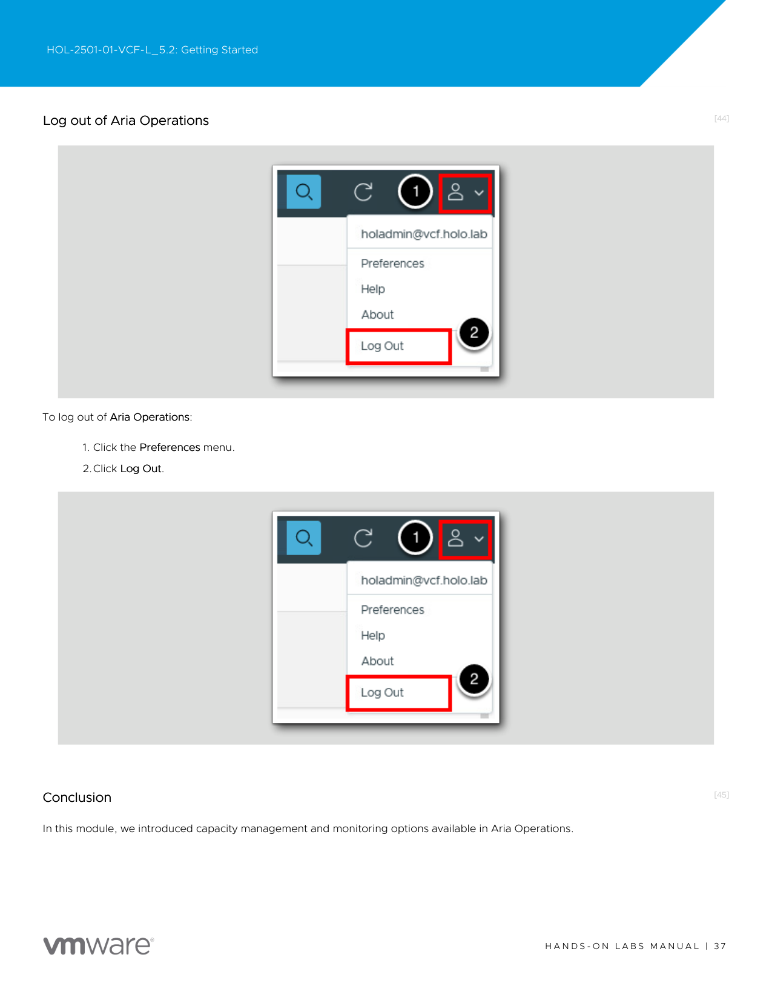

#### 4. Logout

---

## Module 3 — Mastering Monitoring and Troubleshooting Essentials (30 phút)

- **Mục tiêu:** Hiểu cấu trúc Alert trong Aria Operations (Symptom → Alert Definition → Policy) và thực hành quản lý vòng đời alert
- **Mục đích:** Trang bị kỹ năng tạo, tùy chỉnh và xử lý cảnh báo để vận hành hệ thống ổn định
- **Lợi ích thực tiễn:** Giảm nhiễu cảnh báo nhờ tùy chỉnh ngưỡng thông minh; tự động hóa remediation; phản ứng nhanh với sự cố trước khi ảnh hưởng đến người dùng

### Chi tiết các bước thực hành

### Lesson 1 — Introduction to Alert Components

#### 1. Alert Components Overview

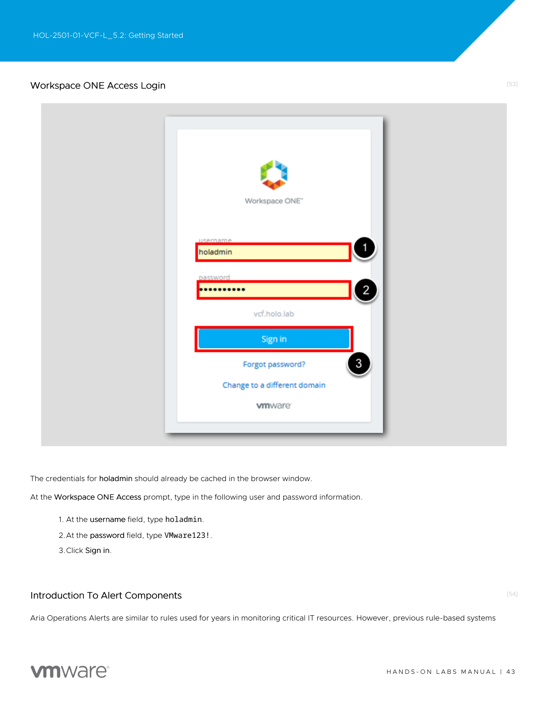

**Symptom Definitions** — điều kiện đánh giá trạng thái môi trường:
- **Static Thresholds:** So sánh metric với giá trị cố định (VD: CPU > 90%)
- **Dynamic Thresholds:** So sánh với trend bình thường (VD: CPU vượt trend)
- **Message Events:** Dựa trên message từ REST API hoặc adapter
- **Faults:** Dựa trên fault events từ monitored systems

**Cấu trúc Symptom:** `ObjectType > Metric > Operator > Threshold`

#### 2. Examine DNS Symptom Definition

1. `Operations > Configurations > Alerts > Symptom Definitions`
2. Filter "DNS" → Edit "A DNS forwarder is down"
3. Xem syntax: Condition = "Matches regular expression", Value Expression, Trigger Condition

#### 3. Examine DNS Alert Definition

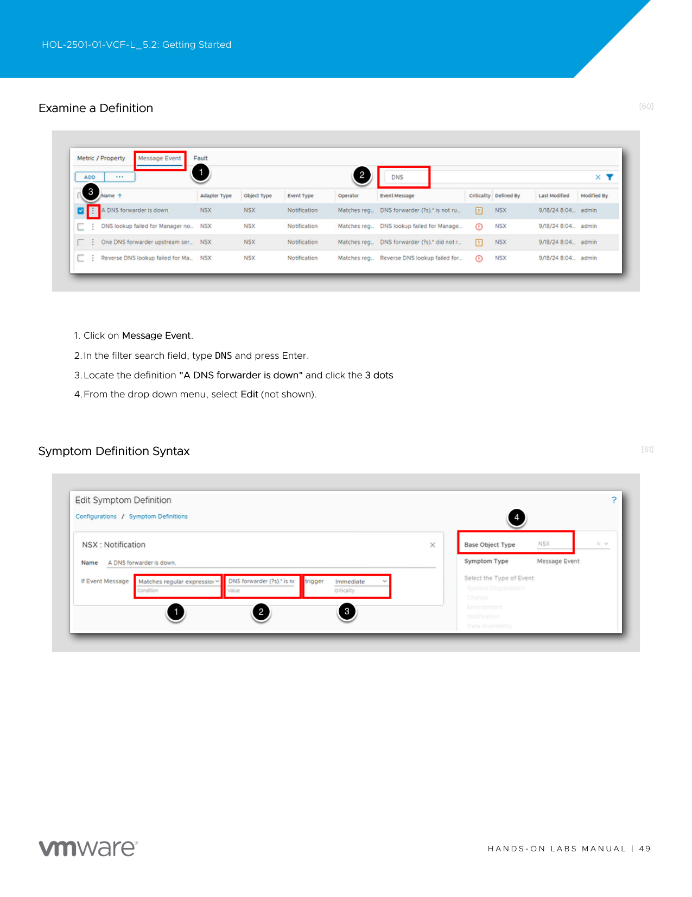

1. `Operations > Configurations > Alerts > Alert Definitions`
2. Filter "DNS" → Edit "A DNS forwarder is down"

**Advanced Settings:**
- **Impact:** Health / Risk / Efficiency
- **Criticality:** Informational → Critical
- **Alert Type & Subtype**
- **Wait Cycle:** Số collection cycles trước khi alert sinh ra
- **Cancel Cycle:** Số cycles trước khi alert tự hủy

**Base Object Types:** vCenter, ESXi, VM, NSX, vSAN...

**Symptoms / Conditions:** Gán symptom → chọn AND/OR logic

**Recommendations:** Text instructions hoặc actions (power off, modify VM...)

**Policies:** Xác định phạm vi alert hoạt động

### Lesson 2 — Working with Alerts

#### 4. Chuẩn bị môi trường — Tạo CPU Load

1. Log vào **vCenter** (`administrator@vsphere.local` / `VMware123!`)
2. **Power on** Ubuntu VM (`ubuntu-001218`)
3. **PuTTY** vào Ubuntu VM (`holuser` / `VMware123!`)
4. Chạy lệnh tạo CPU load:
   ```bash
   cat /dev/zero > /dev/null
   ```

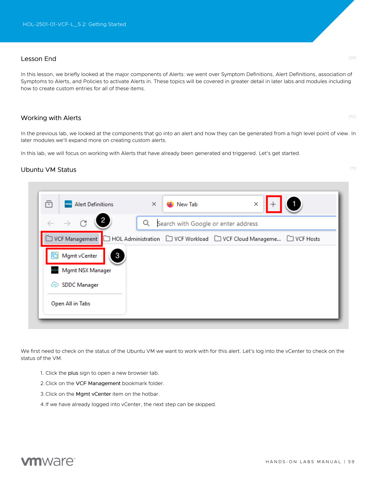

#### 5. Tùy chỉnh Symptom — Edit Threshold

1. `Operations > Configurations > Symptom Definitions`
2. Filter "High CPU" → Edit
3. Đổi threshold từ 90 → **50**
4. SAVE

#### 6. Gán Policy cho Alert Definition

1. `Operations > Configurations > Alert Definitions`
2. Filter "High CPU Alert" → Edit
3. Vào tab **4-Policies**
4. Check **vSphere Solution's Default Policy**
5. UPDATE

#### 7. Quản lý Alert

1. `Operations > Alerts`
2. Group By: **Criticality**
3. Expand **Critical** group → Click alert "Hands-On Labs High CPU Alert"
4. Xem **Alert Details:** Triggered symptoms, Recommendations (trống), Potential Evidence


#### 8. Thêm Recommendation

1. `Operations > Configurations > Alert Definitions`
2. Edit "Hands-On Labs High CPU Alert"
3. **Recommendations** tab → Search "power off"
4. Drag **"Power off this virtual machine..."** vào vùng thả
5. UPDATE

#### 9. Thực thi Action & Dọn dẹp

1. Vào Alerts → Click alert → **POWER OFF VM** recommendation
2. **BEGIN ACTION** → OK
3. **ACTIONS → Cancel Alert** → YES → OK

---

## Module 4 — Running a Safe and Compliant Cloud (30 phút)

- **Mục tiêu:** Kích hoạt và sử dụng Compliance Benchmarks (DISA), tạo báo cáo tuân thủ, quản lý alert compliance và tạo custom benchmark riêng
- **Mục đích:** Giúp tổ chức đảm bảo môi trường VMware tuân thủ các tiêu chuẩn ngành (PCI-DSS, HIPAA, DISA)
- **Lợi ích thực tiễn:** Đáp ứng yêu cầu kiểm toán; giảm rủi ro bảo mật; tự động phát hiện vi phạm; linh hoạt tạo chuẩn tuân thủ riêng phù hợp tổ chức

### Chi tiết các bước thực hành

#### 1. Giới thiệu Compliance

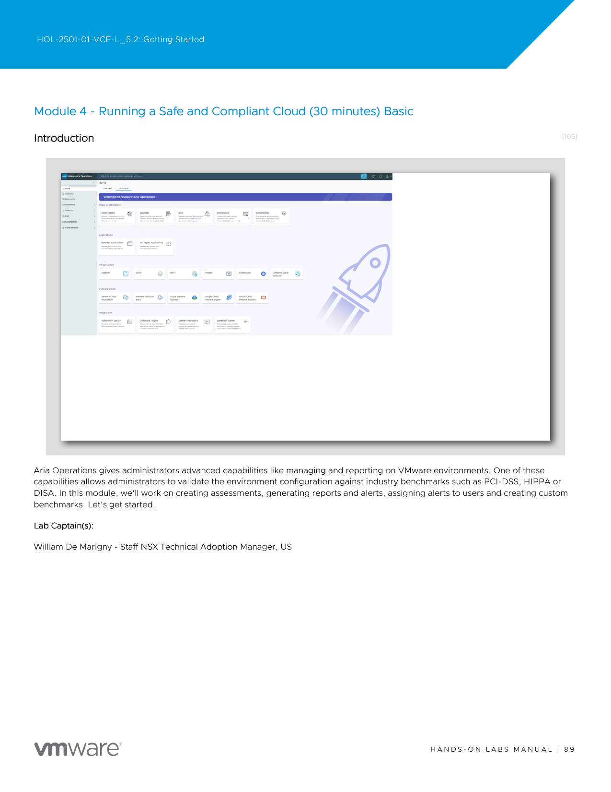

Workflow: **Benchmark → Assessment → Report → Alert**

#### 2. Activate DISA Compliance

1. `Administration > Integrations > Repository`
2. Filter **Compliance** → Click **DISA Compliance** tile
3. **ACTIVATE** → Yes
4. Đợi "Integration activated successfully" (có thể mất vài phút)

#### 3. Enable DISA cho vCenter

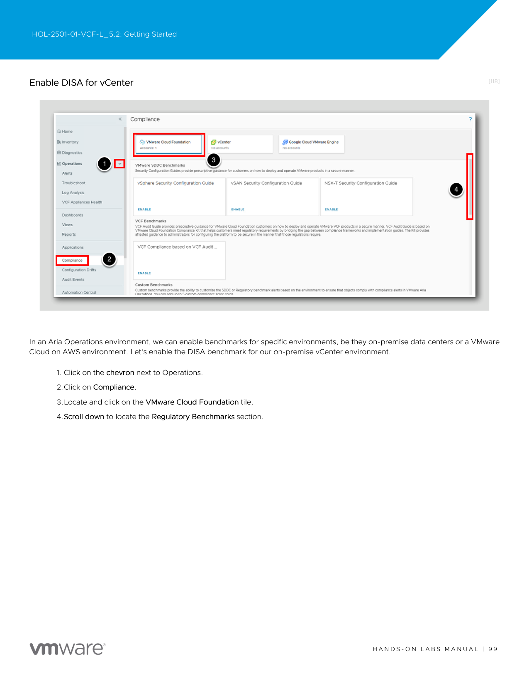

1. `Operations > Compliance` → Click **VMware Cloud Foundation** tile
2. Scroll đến **Regulatory Benchmarks**
3. Click **ENABLE** trên DISA Security Standards tile
4. Check **vSphere Solution's Default Policy**
5. **ENABLE**

#### 4. Initial Assessment

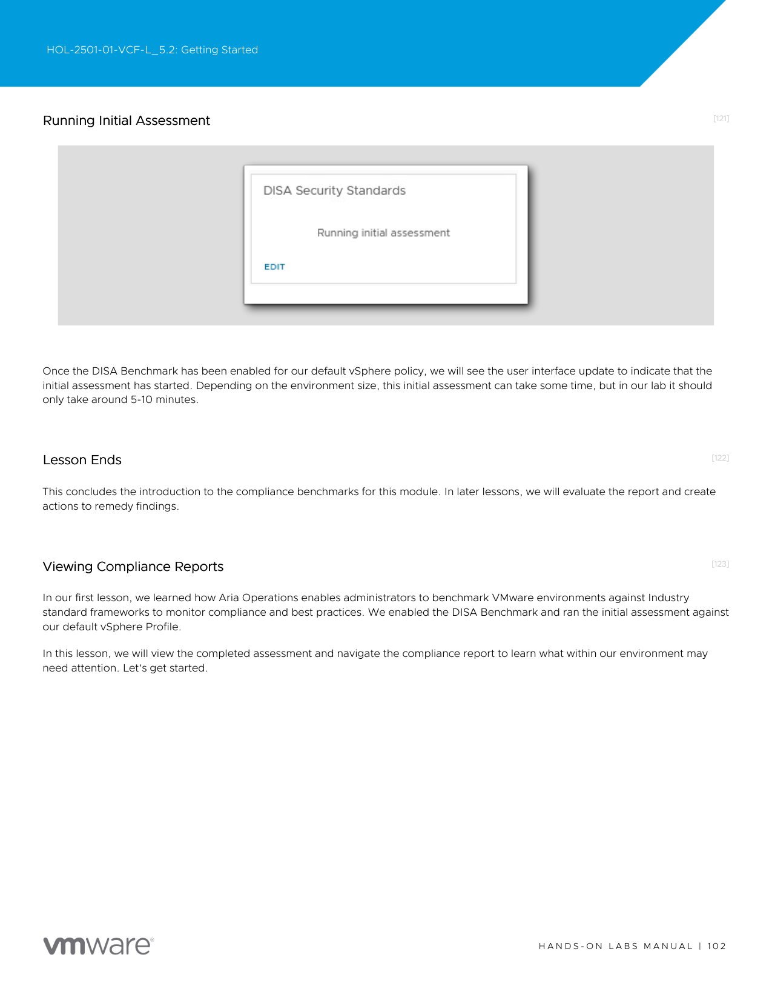

- UI thông báo assessment đã bắt đầu
- Mất ~5-10 phút tùy môi trường

#### 5. Xem Compliance Report

1. `Operations > Compliance` → Click **DISA Security Standards**
2. View compliance % và object breakdown (Compliant / Non-Compliant)
3. **Group By** → chọn **Object Type**
4. Expand **Host System** → Click host `esxi-4.vcf.sddc.lab`
5. Click alert vi phạm (VD: "The SSH connection banner is not set")
6. Xem chi tiết symptom, alert description, last changed details

#### 6. Quản lý Alert Compliance

1. Tab **Alerts** của host
2. Group By → **Object Type**
3. Expand host → Click "ESXi Host is violating DISA"
4. **Thêm Note:** "SSH should be our priority" → SUBMIT

#### 7. Assign Ownership

1. **ACTIONS → Assign To**
2. Nhập "hol" → Chọn `holadmin@vcf...`
3. **SAVE**

#### 8. Tạo Custom Benchmark

1. `Operations > Compliance` → **Add Custom Compliance**
2. **CREATE A NEW CUSTOM BENCHMARK**
3. Name: `HOL Custom Benchmark`
4. Description: `This benchmark is a custom subset of the DISA benchmark`
5. **NEXT**
6. **Show Columns Filter** → Select All → OK
7. **Defined By** → chọn **DISA Compliance**
8. Check **ESXi Host is violating DISA (v8 and above)**
9. **NEXT**
10. Check **vSphere Solution's Default Policy**
11. **FINISH**

---

## Module 5 — Understand your Cloud Costs and Save Money (30 phút)

- **Mục tiêu:** Thiết lập tiền tệ, sử dụng Cost Dashboards để theo dõi và tối ưu chi phí VM, hiểu Cost Drivers và Rightsizing
- **Mục đích:** Giúp tổ chức định lượng chi phí vận hành Private Cloud, xác định cơ hội tiết kiệm
- **Lợi ích thực tiễn:** Trả lời câu hỏi "một VM tốn bao nhiêu?"; phát hiện VM lãng phí (oversized, powered-off, idle); tối ưu CAPEX/OPEX; hỗ trợ quyết định mua sắm dựa trên dữ liệu

### Chi tiết các bước thực hành

#### 1. Thiết lập Currency

1. `Administration > Global Settings > Cost/Price`
2. Kiểm tra currency (US Dollars đã được cấu hình sẵn)
3. ⚠️ Lưu ý: Thiết lập currency chỉ 1 lần, muốn đổi phải rebuild environment

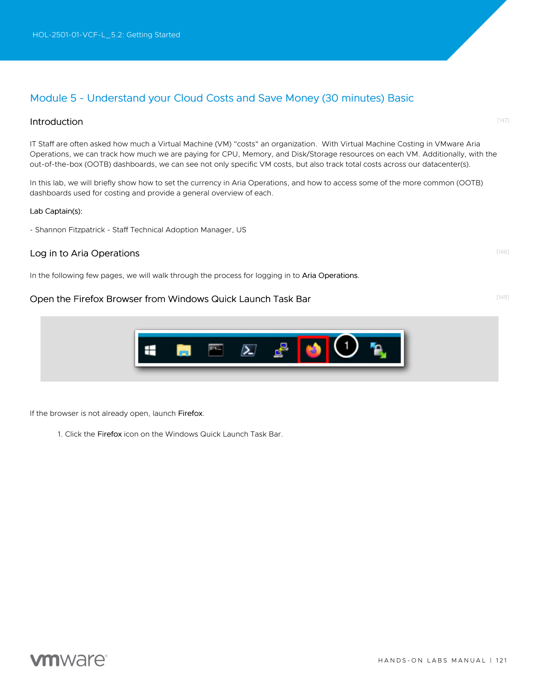

#### 2. Assess Cost Dashboard

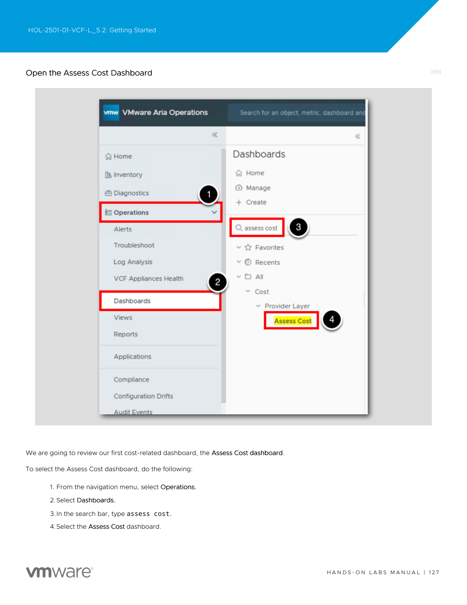

1. `Operations > Dashboards` → search "assess cost"
2. Xem:
   - **Total Cost of Ownership**
   - **Potential Cost Saving Opportunities**
   - **Datacenter Resource Cost**
   - **Top Most / Least Expensive Clusters**

#### 3. Total Cost of Ownership Dashboard

1. `Operations > Dashboards` → search "total cost" → **Total Cost of Ownership**
2. **Cost Driver Breakdown:** Server HW, Storage, Network, Labor, Facilities
3. **Cost of Capacity Used vs Capacity Remaining**
4. **Cost per Datacenter** + Trend over time

#### 4. Potential Cost Savings Dashboard

1. `Operations > Dashboards` → search "potential" → **Potential Cost Savings**
2. Xem:
   - **Cost Savings Breakdown:** idle VMs, powered off VMs, snapshots, orphaned disks, oversized VMs
   - **Reclaimable Capacity:** vCPU, Memory, Disk Space
   - **Allocation Changes for Oversized VMs**
   - **Optimization Opportunities Breakdown:** undersized VMs

#### 5. Realized Cost Savings Dashboard

1. `Operations > Dashboards` → search "realized" → **Realized Cost Savings**
2. Xem:
   - **Realized Savings & Capacity**
   - **Reclaimed Capacity:** vCPU/Memory/Disk đã reclaim
   - **Allocation Changes for Oversized VMs**
   - **Cost of Deleted VMs** (30 days & Year to Date)

#### 6. Cost Drivers Configuration

1. `Configurations > Cost > Cost Drivers`
2. Chọn **Infrastructure Type:** vCenter / VMware Cloud
3. Click **Server Hardware: Hyper-Converged**
4. Expand server group → Sửa:
   - **Cost Per Server:** 25000
   - **Compute Percentage (%):** 80
5. **SAVE** — Monthly cost sẽ thay đổi

#### 7. Reclamation Settings & VM Rightsizing

1. `Operations > Capacity > Reclaim`
2. **SETTINGS** → Cấu hình:
   - VM Idleness Criteria
   - Powered Off VMs
   - Idle VMs, Snapshots, Orphaned Disks
3. Click datacenter `mgmt-datacenter-01` để view reclaim options

#### 8. VM Rightsizing Details Dashboard

1. `Operations > Dashboards` → search "vm rightsizing" → **VM Rightsizing Details**
2. Select **vSphere World**
3. Xem:
   - **Oversized VMs** — list VM được đề xuất giảm tài nguyên
   - **VM Status:** Projected monthly cost, VM Tools status
   - **VM CPU/Memory Configuration:** Current + Hot Add/Remove
   - **CPU/Memory Utilization** (95th Percentile)

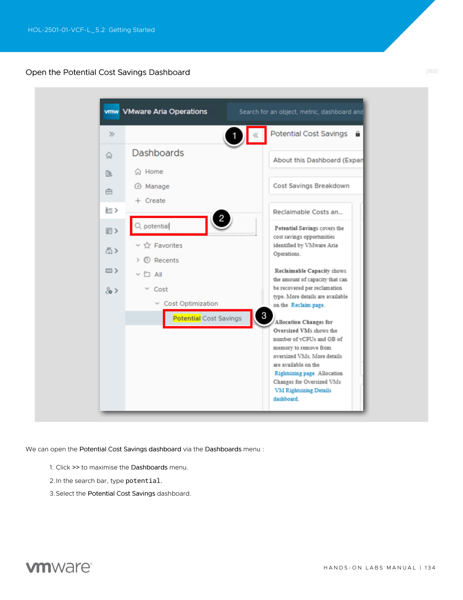

---

## Module 6 — Generating Reports for Cost, Capacity, Compliance and More (30 phút)

- **Mục tiêu:** Tạo, clone, schedule và download các báo cáo trong Aria Operations
- **Mục đích:** Cung cấp kỹ năng tạo báo cáo định kỳ phục vụ quản lý và ra quyết định
- **Lợi ích thực tiễn:** Tự động hóa báo cáo gửi qua email; tùy chỉnh nội dung báo cáo từ các view có sẵn; hỗ trợ kiểm toán và trình bày với lãnh đạo

### Chi tiết các bước thực hành

### Lesson 1 — Introduction to Reports

#### 1. Locate Reports

1. `Operations > Reports`
2. **Report Templates** pane


#### 2. Run a Basic Report

1. Search "Capacity Report" → Check **Capacity Report - Datastores**
2. Click 3-dots → **Run**
3. Select object: `vSphere World > VCF_mgmt-domain > mgmt-datacenter-01 > wld-cluster-01`
4. **OK**

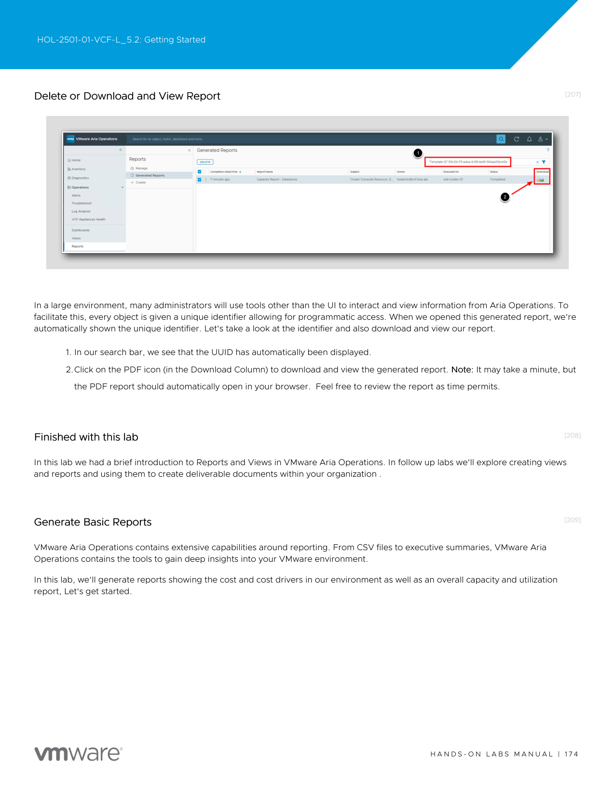

#### 3. View Generated Report

1. Click số **Generated Reports** (màu xanh)
2. Xem **UUID** của report
3. Click **PDF icon** để download và xem báo cáo

### Lesson 2 — Generate Basic Reports

#### 4. Clone Cluster Cost Report

1. Search "Cluster Cost" → 3-dots → **Clone**
2. Đổi tên: `HOL Cost Report`
3. **NEXT**

#### 5. Add Views

1. Search "compute cost" trong **Views and Dashboards** pane
2. Drag **Compute Cost Drivers** view vào left pane
3. **Create**

#### 6. Run Cloned Report

1. `Manage` → Filter "Cost"
2. 3-dots → **Run**
3. Select `wld-cluster-01` → **OK**

#### 7. Schedule Capacity Report

1. Search "capacity" → **Capacity Report - Environment**
2. 3-dots → **Schedule**
3. Select `wld-cluster-01` → **OK**
4. Chọn **Pacific Time Zone**
5. Check các ngày trong tuần
6. **FINISH**

#### 8. Download Reports

1. **Generated Reports**
2. Filter "Capacity" hoặc "Cost"
3. Click **PDF icon** để tải về

---

## Module 7 — Visualizing the Health of your Private Cloud with VCF Diagnostics (15 phút)

- **Mục tiêu:** Làm quen với VCF Diagnostics — công cụ tổng quan sức khỏe Private Cloud VCF
- **Mục đích:** Giúp quản trị viên nhanh chóng nắm được tình trạng tổng thể hệ thống VCF qua một dashboard duy nhất
- **Lợi ích thực tiễn:** Phát hiện sớm các vấn đề tiềm ẩn (certificate sắp hết hạn, vMotion lỗi, snapshot treo); tiết kiệm thời gian troubleshooting nhờ thông tin tập trung; hỗ trợ pre-upgrade check

### Chi tiết các bước thực hành

#### 1. Giới thiệu VCF Diagnostics

**VCF Diagnostics** = VMware Skyline Health Diagnostics + VMware Skyline Advisor + Aria Operations for Logs

**Diagnostic Finding — các thông tin cung cấp:**
- **Severity:** Critical, Immediate, Warning
- **VCF Component:** vCenter, ESXi, NSX, Aria Operations, Aria Automation, SDDC Manager, vSAN
- **Capability:** vMotion, Snapshot, Workload Planning, Workload Domain Provisioning, DRS, HA
- **Finding Type:** Availability, Security, Operations Diagnostics, Pre-Upgrade Check, Product Interoperability
- **Category:** Management, Compute, Storage, Network, Security

#### 2. Navigate to Diagnostics

1. Click **Diagnostics** trong navigation menu

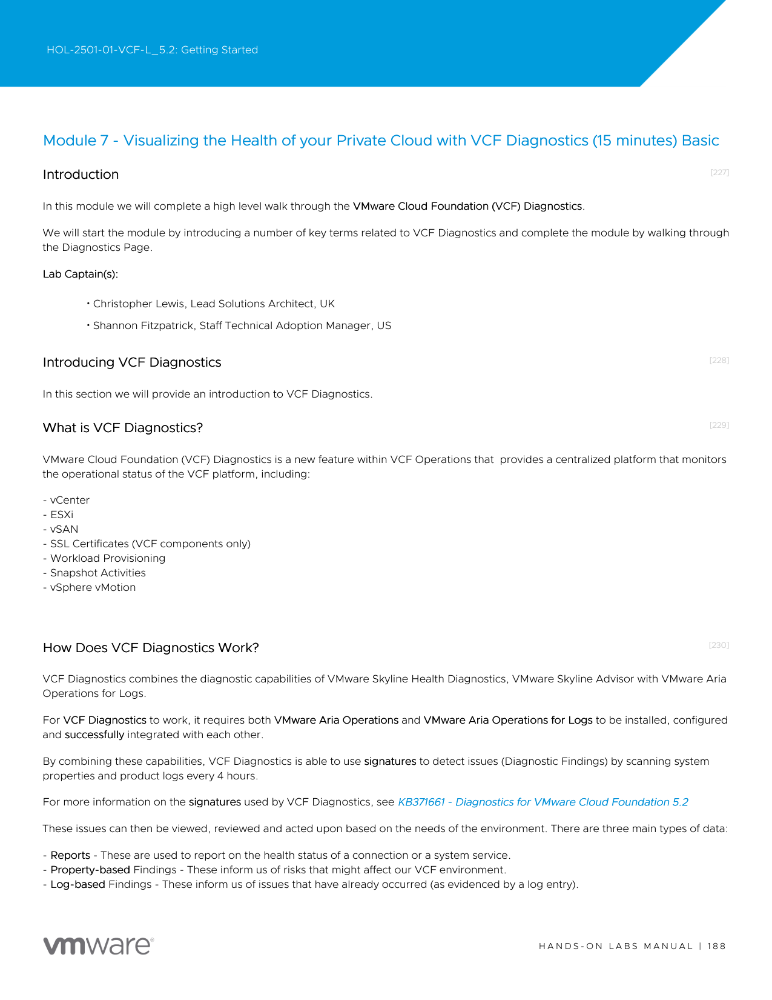

#### 3. Review Diagnostics Page

**Part 1 — Overview Cards:**
- **Overall Findings:** Tổng số findings, phân theo severity
- **Security Advisories:** VMSAs (VMware Security Advisories) còn thiếu
- **Certificates:** Certificate active / expired

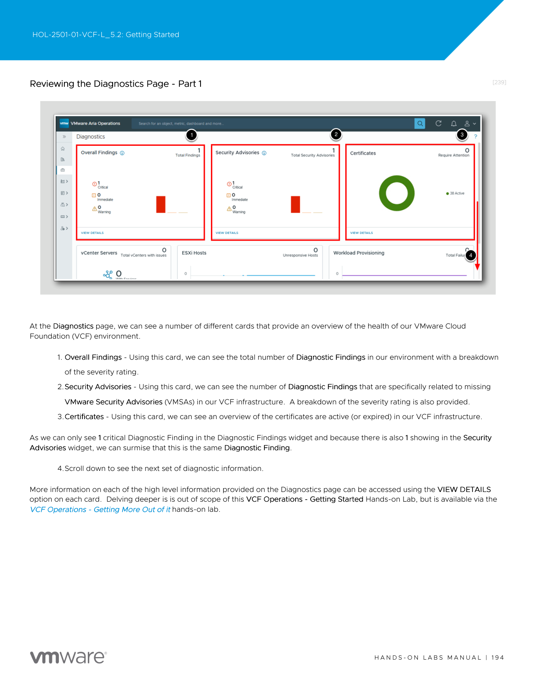

**Part 2 — Infrastructure Health:**
- **vCenter Servers:** Health status, unhealthy services, network reachability
- **ESXi Hosts:** Unresponsive hosts (không trong maintenance mode)
- **Workload Provisioning:** VM provisioning operations đang diễn ra

**Part 3 — Operational Health:**
- **vMotions:** Fleet-wide overview, successful/failed vMotion
- **Snapshots:** Tổng số snapshot events, failed snapshot events
- **vSAN Clusters:** vSAN cluster health

#### 4. View Details

- Mỗi card có **VIEW DETAILS** để xem chi tiết
- Các module nâng cao được đề cập trong lab "VCF Operations - Getting More Out of it"

---

## Appendix — Hands-on Labs Interface

- **Windows Main Console:** Firefox Quick Launch, Extend Time, keyboard shortcuts
- **Ubuntu Main Console:** Tương tự giao diện Ubuntu
- **Tips:** Click & Drag nội dung Lab Manual vào console; Online International Keyboard cho ký tự đặc biệt
- **Video hướng dẫn:** https://www.youtube.com/watch?v=xS07n6GzGuo

---

## Tổng kết

Sau khi hoàn thành lab, học viên có thể:

| Module | Kỹ năng đạt được |
|--------|------------------|
| 1 | Đăng nhập, điều hướng Aria Operations |
| 2 | Đánh giá dung lượng, forecast capacity |
| 3 | Tạo/quản lý alert, symptom, recommendation |
| 4 | Kích hoạt compliance benchmark (DISA), custom benchmark |
| 5 | Theo dõi chi phí VM, cost drivers, rightsizing |
| 6 | Tạo, clone, schedule, download báo cáo |
| 7 | Xem health tổng thể VCF qua Diagnostics |
